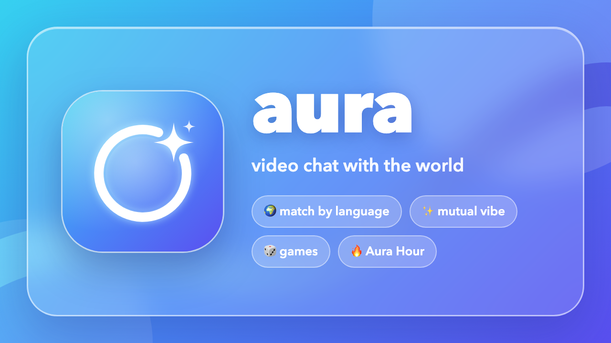
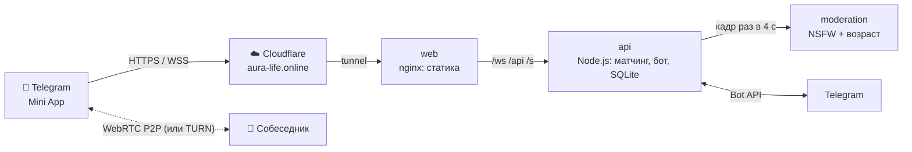

<div align="center">



# Aura

**Видеорулетка с людьми со всего мира — прямо в Telegram.**
Свайп — новый собеседник, подбор по языку, взаимный «вайб», игры в звонке и паспорт стран.

[](https://t.me/you_aura_bot)
[](https://aura-life.online)


</div>

---

## Что это

Aura — Telegram Mini App для видеознакомств со случайными людьми. Без регистрации: вход — подписанные данные Telegram. Видео идёт напрямую между телефонами (WebRTC), сервер только сводит пары, пересылает сигналы и следит за безопасностью.

| | |
|---|---|
| 🎥 **Видео в один свайп** | Свайп влево или «Далее» — новый собеседник за секунды |
| 🌍 **Подбор по языку** | До 5 языков, сводим только при общем. «Русский + English» = практика английского с иностранцами |
| ✨ **Взаимный вайб** | Нажали оба — открываются Telegram-контакты. Односторонний вайб никто не видит |
| 🛂 **Паспорт Aura** | Флаг собеседника, штамп за каждую новую страну, паспорт в Stories |
| 🎯 **Угадай, откуда он** | Первые 20 секунд страна скрыта — 4 флага на выбор, +10 aura за верный ответ |
| 💌 **Анонимные комплименты** | «Улыбка», «Смешно», «Голос»… после разговора — и коллекция в паспорте |
| 💫 **Реакции и салюты** | ❤️ 😂 🔥 👏 летят поверх видео; 🎆 салют за Stars — получателю +aura и Premium за каждые 10 |
| 📸 **Aura Moment** | Общее фото по согласию обоих: отсчёт 3-2-1, карточка-полароид для Stories |
| 🔮 **Aura Wrapped** | Итоги недели и «тип ауры» — каждое воскресенье в боте, карточка для Stories |
| 🧵 **Нити** | История, вопрос миру или пожелание идут от разговора к разговору по всему миру: ход — и передал дальше. Финал с маршрутом по карте, уведомления о пути своей нити, карточка для Stories |
| 👫 **Duo 2×2** | Двое друзей вместе знакомятся с другой парой: сетка из четырёх видео |
| 🎧 **Сначала голос** | Лицо проявляется по ходу разговора, аура «дышит» в такт голосу |
| 🎲 **Игры в звонке** | Тема для разговора, камень-ножницы-бумага, «Не смейся» (детектор улыбки на устройстве) |
| 🎭 **Маска** | Эмодзи вместо лица (MediaPipe на устройстве) для стеснительных |
| 🔥 **Aura Hour** | Каждый вечер — короткие раунды и максимум людей онлайн |
| 📢 **Комнаты каналов** | Своя рулетка для подписчиков канала + партнёрская программа Telegram |
| 👑 **Premium за Stars** | Безлимитный фильтр «кого ищу» и приоритет в очереди |
| 🛡️ **Безопасность** | Автомодерация NSFW, оценка возраста по лицу, жалобы, аура-карма, баны |

## Архитектура



Подробно: [docs/architecture.md](docs/architecture.md).

## Быстрый старт (локально)

```bash
npm install
npm run dev      # http://localhost:8080 — без Telegram, Premium выдаётся бесплатно
npm test         # 51 тест: подпись, матчинг, языки, комнаты, аура, вайб, паспорт, возраст, платежи, нити
```

Откройте две вкладки — каждая получает свою тестовую личность, и они соединятся друг с другом. Язык интерфейса: `?lang=en|ru|uk|es|pt|de|tr|id`, комната/реферал: `?startapp=room_test`.

## Развёртывание

| Вариант | Когда | Документация |
|---|---|---|
| **VPS** (Docker Compose: Caddy, nginx, api, coturn, модерация) | Продакшен, белый IP, свой TURN | [docs/deployment.md#vps](docs/deployment.md#vps) |
| **TrueNAS** (custom app + Cloudflare Tunnel) | Домашний сервер за CGNAT | [docs/deployment.md#truenas](docs/deployment.md#truenas) |

Настройки — [docs/configuration.md](docs/configuration.md), эксплуатация (мониторинг, бэкапы, метрики, модерация) — [docs/operations.md](docs/operations.md).

## Структура

```
src/            бэкенд: server.js (HTTP+WS), matchmaker, duo (2×2), threads (нити), db (SQLite), bot, bot-profile (17 языков),
                moderation-клиент, events (Aura Hour), langs, stories, auth (подпись initData)
public/         Mini App: index.html, app.js, i18n.js (8 языков), games.js, threads.js + worldmap.js (нити, карта), mask.js, face.js, duo.js, style.css
moderation/     FastAPI-сервис: NSFW (Falconsai) + возраст (ViT по лицу), Docker CPU/GPU
deploy/         nginx.conf, Caddyfile, install.sh (VPS), truenas/ (деплой, сторож, ввод токенов)
branding/       логотип, аватар, обложки, тексты для @BotFather
test/           node:test — юнит и сквозные тесты
docs/           архитектура, развёртывание, настройки, эксплуатация
```

## Безопасность и данные

- Вход только с подписанным Telegram `initData` (HMAC), баны по Telegram ID.
- Видео и звук не проходят через сервер и не записываются; кадры для модерации проверяются в памяти и удаляются.
- Секреты (токен бота, ключи туннеля и TURN, токен модерации) — только в файлах с правами 600 на сервере, в репозитории их нет.
- Правила и политика конфиденциальности: [public/terms.html](public/terms.html), [public/privacy.html](public/privacy.html).

---

<sub>Приватный репозиторий. © Aura, все права защищены.</sub>
