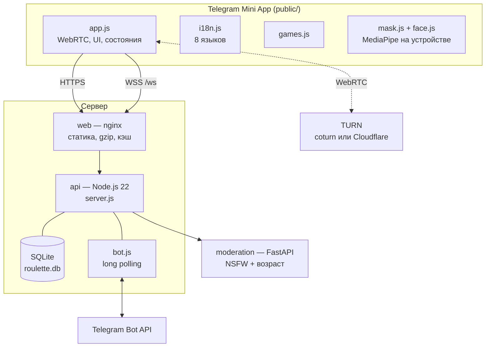
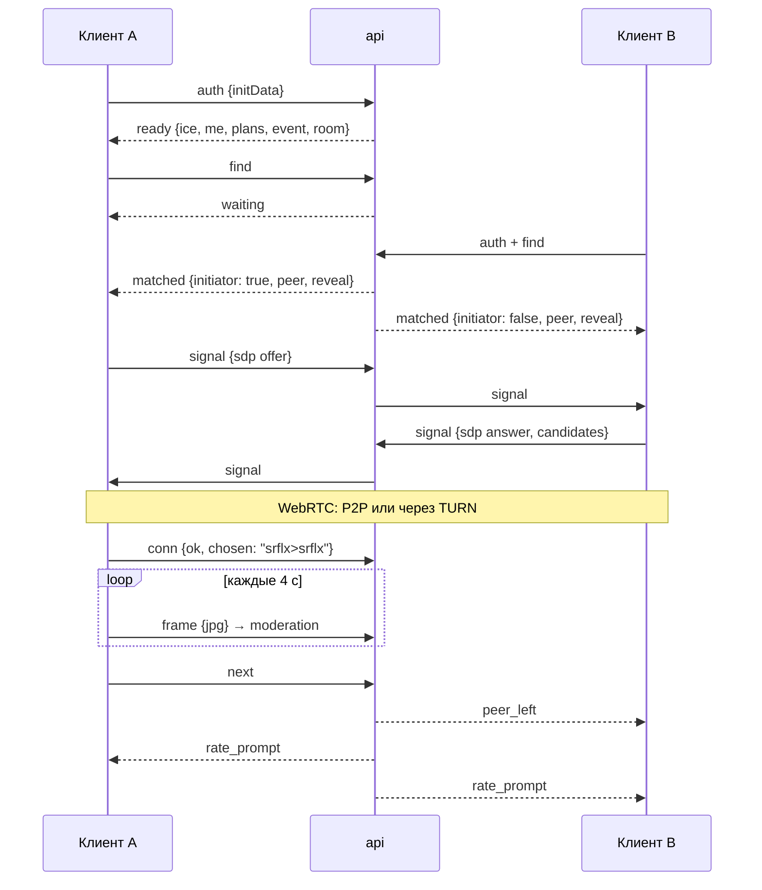

# Архитектура

## Компоненты

- **web** — nginx: отдаёт `public/`, проксирует `/ws` (WebSocket), `/api/`, `/s/` (карточки Stories), `/healthz` в api. Наружу смотрит только он.
- **api** — один процесс Node.js без фреймворков: HTTP + WebSocket (`ws`), матчинг, сигналинг WebRTC, бот, SQLite (`node:sqlite`). При `SERVE_STATIC=0` статику не отдаёт.
- **moderation** — FastAPI: Falconsai NSFW по кадру + `nateraw/vit-age-classifier` по самому крупному лицу (OpenCV Haar). Кадры не сохраняются.
- **TURN** — ретранслятор для пар, у которых не получилось прямое P2P (мобильные сети, CGNAT): свой coturn на VPS или Cloudflare Realtime TURN.

## Жизненный цикл разговора

## Протокол WebSocket

Все сообщения — JSON `{ t: '<тип>', ... }`.

**Клиент → сервер:** `auth`, `profile` (пол, фильтр, языки, режим «Сначала голос», напоминания), `find`, `next`, `stop`, `signal`, `chat`, `game` (игры, маска, раскрытие — пересылается собеседнику), `vibe`, `rate`, `report`, `frame` (кадр для модерации), `conn` (итог WebRTC без IP), `room` (выйти в общую), `invoice`, `allow_pm`.

**Сервер → клиент:** `ready`, `me`, `online`, `waiting`, `matched`, `signal`, `chat`, `game`, `peer_left`, `stopped`, `round_end`, `rate_prompt`, `rated`, `vibe_sent`, `vibe_match`, `streak`, `referral`, `stamp`, `event`, `room`, `reported`, `warning`, `banned`, `invoice`, `error`.

Коды закрытия: `4001` нет auth, `4003` неверная подпись, `4004` бан, `4005` вход с другого окна.

## Матчинг

`src/matchmaker.js` — очередь FIFO с приоритетом Premium.

| Ограничение | Тип |
|---|---|
| Та же комната канала | жёсткое |
| Общий язык | жёсткое |
| Фильтр пола (в обе стороны) | жёсткое |
| Уровень ауры (low/ok) | мягкое: снимается, если оба ждут > 15 с |
| Режим «Сначала голос» | мягкое: снимается, если оба ждут > 15 с |
| Не тот же собеседник подряд | мягкое: снимается, если оба ждут > 10 с |

Раз в 3 с `tick()` перепроверяет очередь. Во время Aura Hour пары разводятся по истечении раунда.

## Данные (SQLite)

| Таблица | Что хранит |
|---|---|
| `users` | пол, фильтр, языки, Premium, аура (karma_up/down), серия дней, страна, режим, бан, рефералы |
| `reports` | жалобы (уникальны по паре) |
| `payments` | платежи Stars (идемпотентны по charge_id) |
| `rooms` | комнаты каналов, заходы и разговоры |
| `ratings` | оценки +aura/−aura (одна в сутки на пару) |
| `passport` | страны, с которыми поговорил пользователь |
| `events` | события для метрик: session, match, call_end, vibe, report, conn_ok/fail, nsfw, age_block, premium |

Миграции — добавлением колонок при старте (`Db` → `USER_COLUMNS`), данные существующих установок не теряются.

## Модерация и безопасность

- Клиент раз в `FRAME_INTERVAL_MS` шлёт уменьшенный кадр **настоящей** камеры (даже в режиме маски).
- NSFW ≥ `NSFW_THRESHOLD` → собеседник отключается, нарушителю страйк; `STRIKES_TO_BAN` страйков → бан на `STRIKE_BAN_HOURS`.
- Возраст: 2 из 3 последних кадров с лицом «младше 20» ≥ `MINOR_THRESHOLD` → бан на `AGE_BLOCK_HOURS` с объяснением.
- Жалобы: `REPORTS_TO_BAN` уникальных за 7 дней → бан на 7 дней.
- Сервис модерации недоступен → кадр пропускается (fail-open) с записью в лог; сторож присылает алерт.
