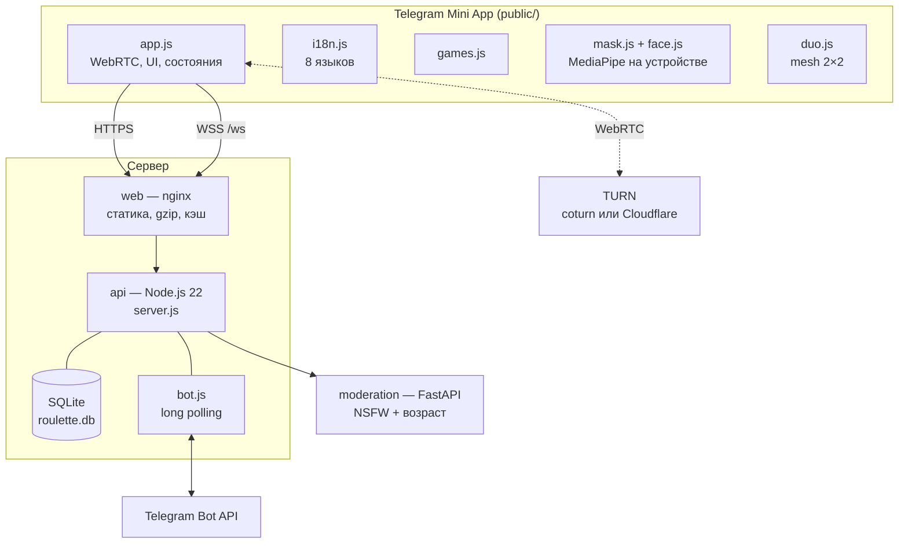
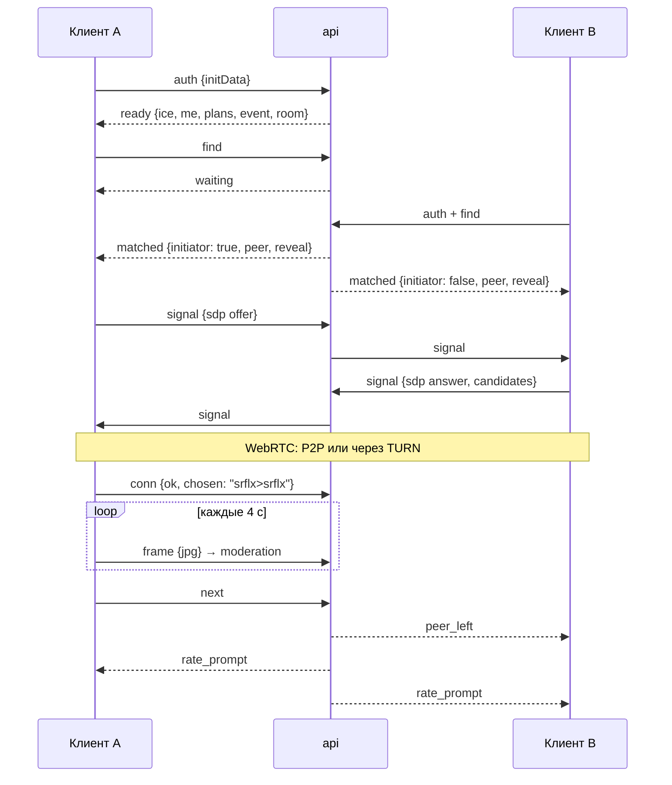

# Архитектура

## Компоненты

- **web** — nginx: отдаёт `public/`, проксирует `/ws` (WebSocket), `/api/`, `/s/` (карточки Stories), `/healthz` в api. Наружу смотрит только он.
- **api** — один процесс Node.js без фреймворков: HTTP + WebSocket (`ws`), матчинг, сигналинг WebRTC, бот, SQLite (`node:sqlite`). При `SERVE_STATIC=0` статику не отдаёт.
- **moderation** — FastAPI: Falconsai NSFW по кадру + `nateraw/vit-age-classifier` по самому крупному лицу (OpenCV Haar). Кадры не сохраняются.
- **TURN** — ретранслятор для пар, у которых не получилось прямое P2P (мобильные сети, CGNAT): свой coturn на VPS или Cloudflare Realtime TURN.

## Жизненный цикл разговора

## Протокол WebSocket

Все сообщения — JSON `{ t: '<тип>', ... }`.

**Клиент → сервер:** `auth`, `profile` (пол, фильтр, языки, режим «Сначала голос», напоминания), `find`, `next`, `stop`, `signal`, `chat`, `game` (игры, маска, раскрытие, Aura Moment — пересылается собеседнику), `vibe`, `rate`, `compliment`, `react`, `guess`, `wrapped`, `report`, `frame` (кадр для модерации), `conn` (итог WebRTC без IP), `room` (выйти в общую), `invoice`, `allow_pm`, `duo_create`, `duo_join`, `duo_search`, `duo_next`, `duo_stop`, `duo_leave`, `duo_signal`.

**Сервер → клиент:** `ready`, `me`, `online`, `waiting`, `matched`, `signal`, `chat`, `game`, `peer_left`, `stopped`, `round_end`, `rate_prompt`, `rated`, `vibe_sent`, `vibe_match`, `streak`, `referral`, `stamp`, `guess_result`, `react`, `need_salutes`, `compliment`, `complimented`, `wrapped`, `event`, `room`, `reported`, `warning`, `banned`, `invoice`, `error`, `duo`, `duo_waiting`, `duo_matched`, `duo_signal`, `duo_ended`, `duo_error`.

## Вирусные механики

| Фича | Как устроено |
|---|---|
| «Угадай, откуда он» | Если страны собеседников известны и различаются, `matched.peer.country = null`, вместо неё `guess.options` (4 флага). Ответ `guess` → `guess_result` (+10 aura за верный). Через 20 с — ответ с `ok: null`. Штамп паспорта приходит вместе с ответом, чтобы не раскрыть страну |
| Комплименты | 3 минуты после разговора ≥ `RATE_MIN_SECONDS`: `compliment {kind}` (smile, funny, smart, kind, voice, world). Анонимно, одна на пару в сутки, засчитывается как +aura. Офлайн-получателю — сообщение бота |
| Реакции | `react {kind}`: ❤️ 😂 🔥 👏 бесплатно, 🎆 салют — из купленных пачек (Stars). Получатель салюта: +5 aura, каждые 10 — сутки Premium. Звёзды получателю не передаются |
| Aura Moment | Согласие обоих через `game {g:'moment'}` → отсчёт 3-2-1 → карточка 1080×1920 собирается на устройстве из двух кадров → Stories / сохранить |
| Aura Wrapped | `wrapped` → итоги 7 дней из `events`/`passport`/`compliments` и «тип ауры». В воскресенье 19:00 (часовой пояс аудитории) бот присылает итог с кнопкой `startapp=wrapped` |
| Друзья | взаимный вайб → таблица `friends`; список с «онлайн / в разговоре», звонок `call` → `call_incoming` (онлайн) или сообщение бота со ссылкой `startapp=call_<код>` (2 минуты); принятый звонок — прямая пара (`forcePair`), после неё человек не уходит в общую рулетку (`call_ended`) |
| Комната стримера | `src/live.js`: стример `live_start`, зрители по ссылке `startapp=live_<код>` встают в очередь и по одному (1–5 мин) говорят со стримером; «Далее» у стримера — следующий; имя зрителя стримеру не передаётся; подписка «сообщить, когда начнёт» (`live_subs`) |
| Языковой обмен | профиль `exchange: {native, learn}`; сначала только «зеркальная» пара (мой язык ↔ его изучаемый), через 25 с — любой носитель изучаемого языка; пара получает одинаковый план `{first, second, halfSec}` — таймер на экране, смена языка, 💡 тема от ИИ на текущем языке |
| Первые разговоры | новичок (< 3 разговоров) сводится с «хорошими» (аура ≥ 110), с людьми с плохой репутацией — только после 40 с ожидания |
| Duo 2×2 | `src/duo.js`: Duo по коду или ссылке `startapp=duo_<код>`, поиск другой полной Duo с общим языком, группа из 4 слотов. Клиент — mesh из трёх `RTCPeerConnection`, offer делает меньший слот, видео ограничено 350 кбит/с. Чат и реакции рассылаются всем; игры, вайб и Moment — только 1 на 1 |

Коды закрытия: `4001` нет auth, `4003` неверная подпись, `4004` бан, `4005` вход с другого окна.

## Матчинг

`src/matchmaker.js` — очередь FIFO с приоритетом Premium.

| Ограничение | Тип |
|---|---|
| Та же комната канала | жёсткое |
| Общий язык | жёсткое |
| Фильтр пола (в обе стороны) | жёсткое |
| Уровень ауры (low/ok) | мягкое: снимается, если оба ждут > 15 с |
| Режим «Сначала голос» | мягкое: снимается, если оба ждут > 15 с |
| Не тот же собеседник подряд | мягкое: снимается, если оба ждут > 10 с |

Раз в 3 с `tick()` перепроверяет очередь. Во время Aura Hour пары разводятся по истечении раунда.

## Данные (SQLite)

| Таблица | Что хранит |
|---|---|
| `users` | пол, фильтр, языки, Premium, аура (karma_up/down), серия дней, страна, режим, бан, рефералы |
| `reports` | жалобы (уникальны по паре) |
| `payments` | платежи Stars (идемпотентны по charge_id) |
| `rooms` | комнаты каналов, заходы и разговоры |
| `ratings` | оценки +aura/−aura (одна в сутки на пару) |
| `passport` | страны, с которыми поговорил пользователь |
| `compliments` | анонимные комплименты (кому, от кого, вид, время) |
| `events` | события для метрик: session, match, call_end, talk, vibe, vibe_match, guess_ok, compliment, salute, salute_buy, duo_create/join/call, report, conn_ok/fail, nsfw, age_block, premium |

Миграции — добавлением колонок при старте (`Db` → `USER_COLUMNS`), данные существующих установок не теряются.

## Модерация и безопасность

- Клиент раз в `FRAME_INTERVAL_MS` шлёт уменьшенный кадр **настоящей** камеры (даже в режиме маски).
- NSFW ≥ `NSFW_THRESHOLD` → собеседник отключается, нарушителю страйк; `STRIKES_TO_BAN` страйков → бан на `STRIKE_BAN_HOURS`.
- Возраст: 2 из 3 последних кадров с лицом «младше 20» ≥ `MINOR_THRESHOLD` → бан на `AGE_BLOCK_HOURS` с объяснением.
- Жалобы: `REPORTS_TO_BAN` уникальных за 7 дней → бан на 7 дней.
- Сервис модерации недоступен → кадр пропускается (fail-open) с записью в лог; сторож присылает алерт.
