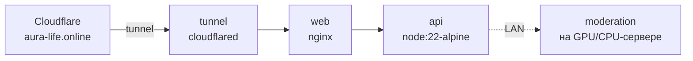

# Развёртывание

## Перед любым вариантом

1. **Бот:** @BotFather → `/newbot`, токен держите в секрете.
2. **Домен** с DNS в Cloudflare (бесплатный тариф) — нужен для HTTPS и стабильного адреса Mini App.
3. **Оформление бота** — `branding/BOT-PROFILE.md`: аватар, картинка описания, Mini App (`/newapp`, short name `app`), Main Mini App, заставка (`branding/splash.svg`).
   Имя, описания и команды на 17 языках бот выставляет сам при старте.

<a id="vps"></a>
## VPS (рекомендуется для продакшена)

Нужно: Ubuntu 22.04/24.04, 2 vCPU / 4 ГБ (8 ГБ — если модерация на том же сервере), белый IPv4.

```bash
git clone <этот репозиторий> /opt/aura && cd /opt/aura
sudo bash deploy/install.sh
```

Скрипт ставит Docker, спрашивает токен, домен и Telegram ID админа, генерирует секреты (`TURN_SECRET`, `MODERATION_TOKEN`), открывает порты и поднимает `docker-compose.yml`:

| Сервис | Назначение | Порты |
|---|---|---|
| caddy | HTTPS (Let's Encrypt) → web | 80, 443 |
| web | nginx: статика + прокси в api | — |
| api | Node.js | — |
| moderation | NSFW + возраст | — |
| coturn | TURN | 3478 tcp/udp, 49160–49999 udp |

Есть NVIDIA GPU → модерация автоматически собирается с CUDA (`docker-compose.gpu.yml`).

DNS: A-запись домена на IP VPS (в Cloudflare — «DNS only», серое облако, чтобы Caddy получил сертификат и не мешал WebSocket; либо оранжевое облако + режим SSL «Full (strict)»).

<a id="truenas"></a>
## TrueNAS (домашний сервер за CGNAT)

Приложение `aura` — custom app из трёх контейнеров, наружу через именованный Cloudflare Tunnel (входящие порты не нужны).



- Код — архивы `api.tgz` и `web.tgz` в датасете `Home_Storage/aura/bundle`, распаковываются при старте контейнеров (свой образ не нужен).
- База и секреты — `Home_Storage/aura/data` (`.env`, `moderation.env`, `turn.env` с правами 600), ключ туннеля — `aura/tunnel/creds.json` (владелец uid 65532).

**Обновление:**
```bash
bash deploy/truenas/update.sh     # собрать архивы → загрузить через API TrueNAS → перезапуск → логи
```

**Секреты вводятся скрыто, мимо чатов и истории shell:**
```bash
ssh -t <хост-с-API-ключом> '~/.hermes/hermes-agent/venv/bin/python ~/aura-deploy/set_token.py'   # токен бота
ssh -t <хост-с-API-ключом> '~/.hermes/hermes-agent/venv/bin/python ~/aura-deploy/set_turn.py'    # TURN Cloudflare
```

**Туннель** (один раз): `cloudflared tunnel login` → `tunnel create aura` → `tunnel route dns aura <домен>` и `www.<домен>`.

Ограничение: без белого IP свой TURN невозможен — используйте Cloudflare Realtime TURN или переезжайте на VPS.

## После развёртывания

- `/start` в боте → кнопка «Aura» открывает приложение.
- `https://<домен>/healthz` → `{"ok":true, "moderation":true, ...}`.
- В @BotFather адрес Mini App (`/editapp` и Main Mini App) = `https://<домен>`.
